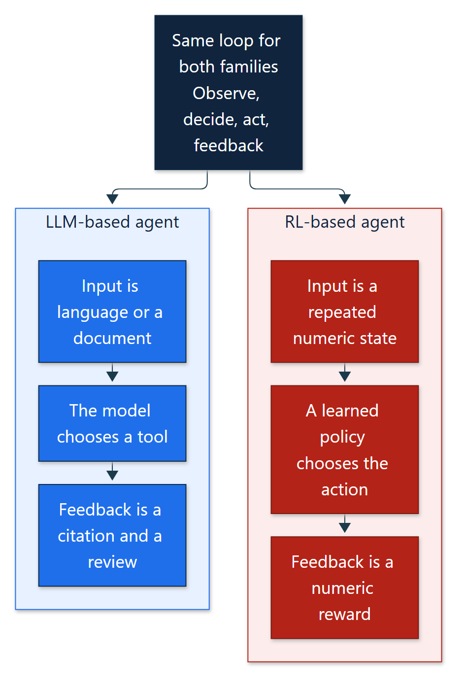

# Module 7 — Design an agent for a real business problem

One meeting (Session 13). Groups of 1–3. About 7 minutes each. This project is **30% of the course**.

Pick a **real process** a firm already runs. Build a **notebook you can run again** next week — on a new ticket, a new day of demand, or a new public feed. The agent can be LLM-based, RL-based, or hybrid. Sessions 1–12 already gave you the pieces; Session 13 is where you put them on one process and keep the file.

The dropbox opens Tuesday, November 17. Report and notebook are due **Monday, December 14, 4:00 pm Central**. Late work loses **10% per day** and is not accepted after **five days**.

Open these files in order.

- `00-Overview.md`
- `Final-Project-Instructions.ipynb` (full guidelines, dataset & approaches ladders)
- `Session-13.ipynb`
- `Report-Template.md`
- `Project-Proposal.md` (short early plan — optional unless Canvas lists a due date)
- `Grading-Rubric.md` (**70 absolute + 30 ranking** across all projects)

## What you submit

1. A notebook that runs the loop — that is the artifact you take with you.
2. The report template, filled in.
3. A ~7 minute talk on Monday, December 14. Any member may be asked who releases the action **and** what the scorecard shows.

A chatbot demo, or a prediction-only model from DAT 5565, is not an agent. The agent has to act, take feedback, and face a baseline. You may still use sklearn, XGBoost, or a DAT 5565 Keras model as a **tool** inside the loop.

## Data and approaches (credit matters)

**Name** the exact dataset or API. Synthetic/toy data is allowed but earns **less** credit; a named public set is mid; a live free API or multi-source setup earns **more**. Combining **more distinct approaches** that really run (rule baseline, LLM+tools, Q-learning, bandit, hybrid veto, …) earns more than a single approach. Renames do not count.

Do not upload confidential employer files, and do not paste them into Colab or a public model.

Examples (you may pick others from [public-apis](https://github.com/public-apis/public-apis)):

| API | Auth | A process it can observe |
| --- | --- | --- |
| [Open-Meteo](https://open-meteo.com/) | No | Weather-sensitive demand or staffing |
| [Frankfurter](https://www.frankfurter.app/docs) | No | FX for a price or a restock |
| [SEC EDGAR](https://www.sec.gov/edgar/sec-api-documentation) | No | A filing the agent must cite |
| [Treasury Fiscal Data](https://fiscaldata.treasury.gov/api-documentation/) | No | A macro state for an RL policy |
| [Nager.Date](https://date.nager.at) | No | Holidays in a staffing or inventory MDP |
| [Portfolio Optimizer](https://portfoliooptimizer.io/) | No | A repeated allocation decision |

## Optional starter problems

You may ignore this list and invent your own process.

| Starter | Typical family | What “solved” looks like |
| --- | --- | --- |
| Refund or claims exception | LLM | Right payout, policy followed |
| Personalized offer | RL (bandit) | Higher payoff than a fixed offer |
| Inventory restock | RL | Service level vs holding cost |
| Document review plus a numeric decision | Hybrid | Language for the exception, a policy for the quantity |
| Service handoff | LLM | The right specialist, with a citation |
| Fraud hold vs. release | Hybrid or LLM | Catch fraud without blocking good payments |

## In class

- Fill the checklist with your group.
- Be ready to talk through the loop, your dataset and approaches, and — in **your own words** — what the scorecard means.
- Talk arc (~7 min): **loop → dataset/approaches → scorecard results → governance**.
- Say who releases the action, and how someone could reuse this artifact next term.

