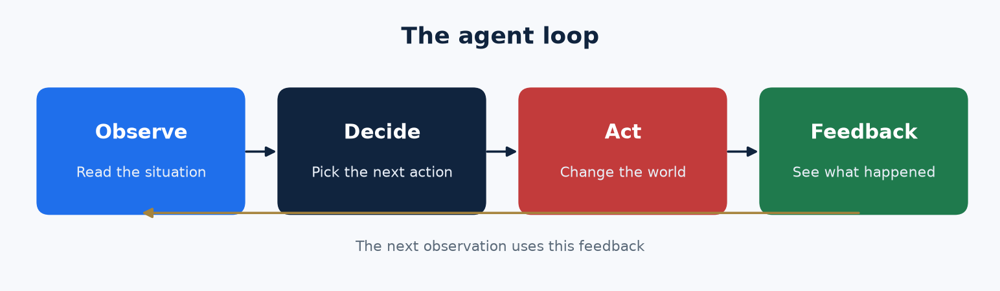
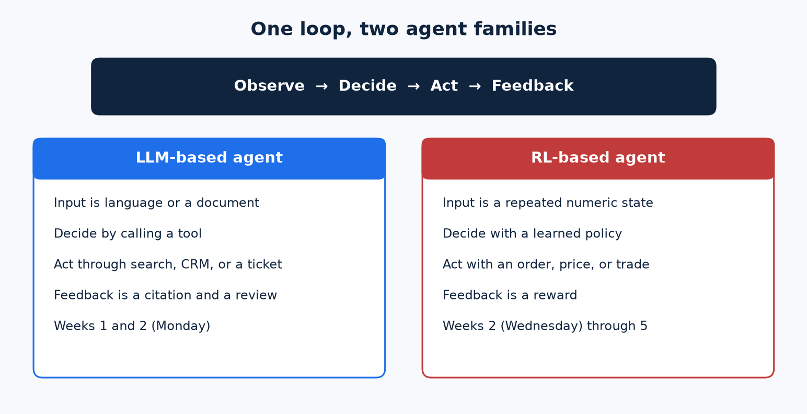

# Two agent families, one course

Agentic AI in this course means a system that **observes, decides, acts, and takes feedback** toward a goal. We teach two ways to build that system. A project may use either family, or both.

## LLM-based agents

The decider is a language model. It acts by **calling tools** over text and documents: search, a policy, a database, a ticket system. It needs grounding, a citation, and a person on the expensive steps.

You build this family in:

- Week 1 Monday and Wednesday — tool loop versus a chatbot
- Week 2 Monday — retrieval, a plan, and a researcher / analyst / reviewer handoff

## RL-based agents

The decider is a **learned policy**. It acts by picking an action in a repeated numeric problem: a price, an order quantity, a trading-style move. Feedback is a reward. This family includes bandits, Markov decision processes, Q-learning, and deep Q-networks.

You build this family in:

- Week 2 Wednesday — bandits
- Week 3 Monday — MDPs
- Week 4 — Bellman updates and tabular Q-learning
- Week 5 — deep Q-networks

## Both

- Week 3 Wednesday — one business process designed both ways, then a go/no-go choice
- Week 6 — the LLM-based agent handles the exception, the RL-based agent releases the frequent action, then you score both
- Week 7 — the project is an LLM-based agent, an RL-based agent, or a hybrid

## Do not swap them

A chatbot is a poor inventory controller. A deep Q-network is a poor contract reviewer. If the input is a document and the action is a cited tool call, use an LLM-based agent. If the input is a repeated state and the feedback is a number, use an RL-based agent.
