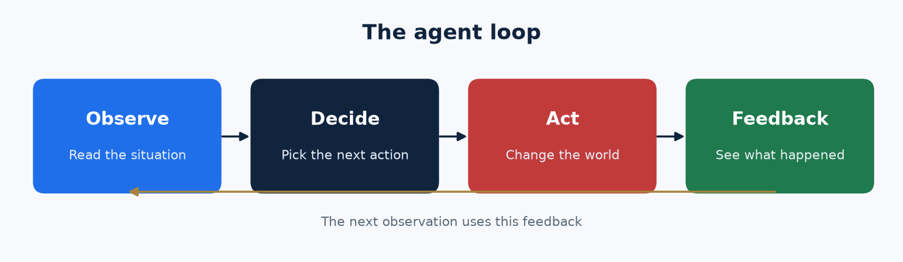
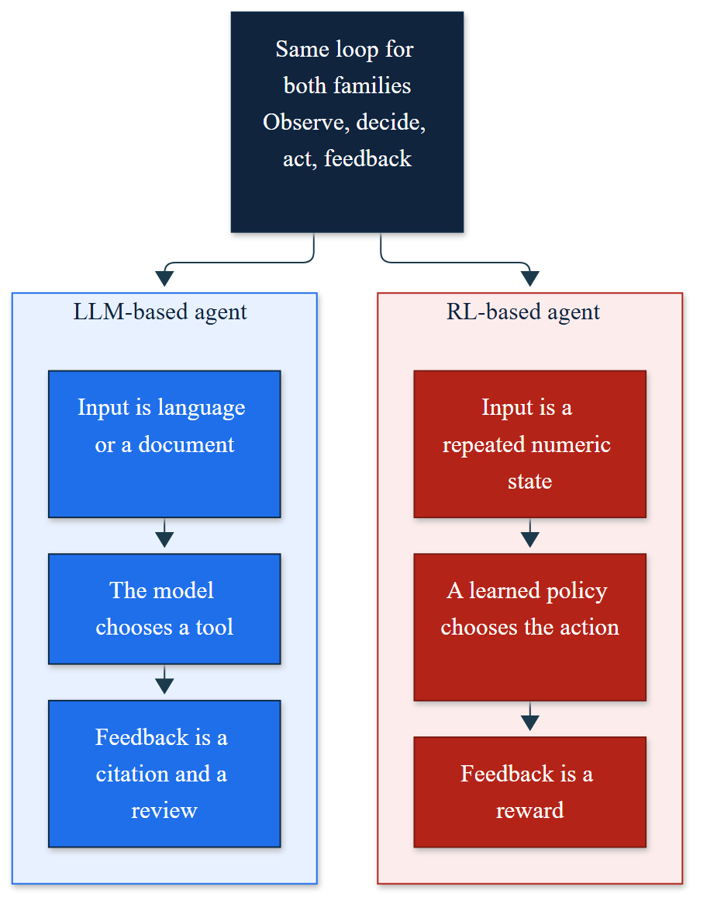
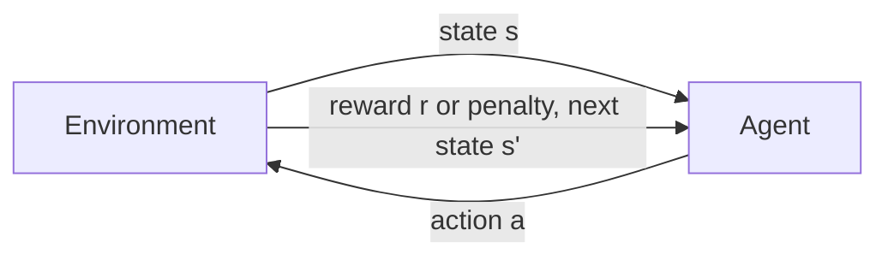

# Two agent families, one loop

You already know Python and supervised models from DAT 5565. This course does not reteach fitting a classifier. It teaches **Agentic AI**: a system that sits in an environment, takes a **state**, returns an **action**, and is scored on what the environment does next.

For the project you pick any real business problem and may use either family below, or both.

## The loop (this is RL)

That diagram is the course. It is reinforcement learning, and we can put a language model in the same boxes.

| You say in Session 1 | RL name | What it is |
| --- | --- | --- |
| Observe | state s | What the desk can see right now |
| Decide | policy | Map s to action a |
| Act | action a | Change the environment (an order, a refund, a mix) |
| Feedback | reward r and next state s' | Gain, loss, or penalty, then the situation you face next |

A chatbot that only writes a paragraph never sends `a` to an environment and never gets `r`. It is not an agent.

## Where machine learning sits

A fitted sklearn, XGBoost, or Keras model can **build the state** (a risk score, a forecast, a class label) or be a **tool** the agent calls. You already know how to train that model. In this course the model is not the agent. The agent is the loop that acts and takes the reward.

## Where the language model sits

An **LLM-based agent** is still this loop. The state may be a ticket or a document. The policy is “call tools, then finish.” The action is a tool call or a booked decision. Feedback is whether the action was allowed and whether a person had to rewrite it.

An **RL-based agent** learns the policy from `r`: bandits, MDPs, Q-learning, deep Q-networks.

A **hybrid** uses both inside the same environment: the learned policy releases the frequent action; the language model (and any ML tools it calls) handles the exception or the veto.

## Evaluation is required

Every agent in this course faces a **baseline** on one scorecard: task success, cost, latency, safety or grounding, and a business KPI. Demo quality is not a metric. Losing to the baseline is an acceptable finding if you say so. Session 12 is that sheet. The project uses the same sheet.

## LLM-based agents

You build this family in:

- Sessions 1 and 2 — tool loop versus a chatbot
- Session 3 — retrieval, a plan, and a researcher / analyst / reviewer handoff

## RL-based agents

You build this family in:

- Session 4 — bandits
- Session 5 — MDPs (state, action, transition, reward, next state)
- Sessions 7 and 8 — Bellman updates and tabular Q-learning
- Sessions 9 and 10 — deep Q-networks

## Both

- Session 6 — one business process designed both ways, then a go/no-go choice
- Sessions 11 and 12 — the LLM-based agent handles the exception, the RL-based agent releases the frequent action, then you **evaluate** both
- Session 13 — the project is an LLM-based agent, an RL-based agent, or a hybrid, scored on the same sheet

## Do not swap them

A chatbot is a poor inventory controller. A deep Q-network is a poor contract reviewer. A prediction-only model from DAT 5565 is not an agent until it sits inside this loop as a tool. If the input is a document and the action is a cited tool call, use an LLM-based agent. If the input is a repeated state and the feedback is a number, use an RL-based agent. If the process has both, say which system releases the frequent action.
